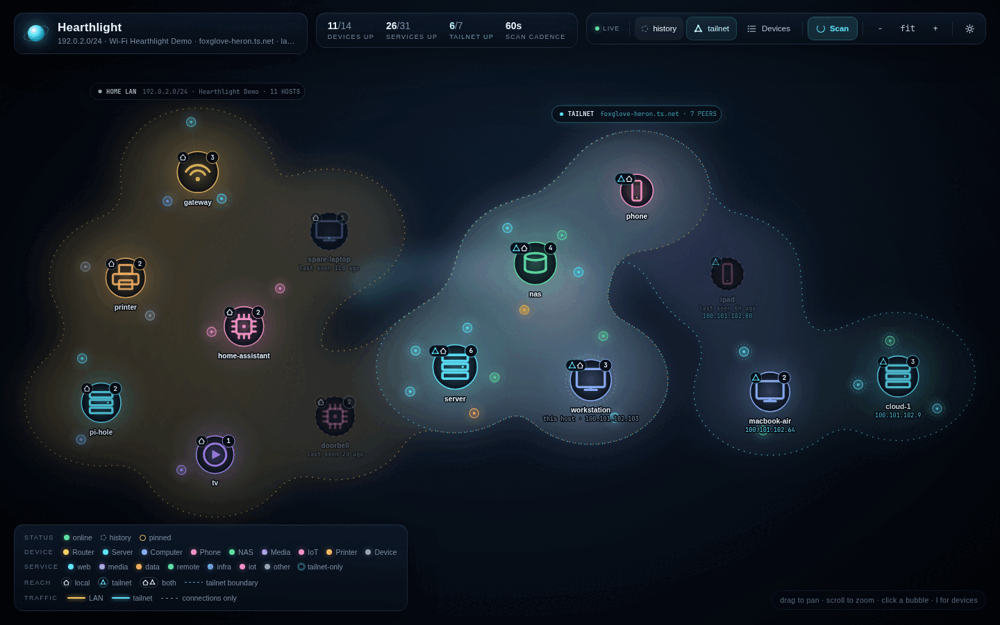
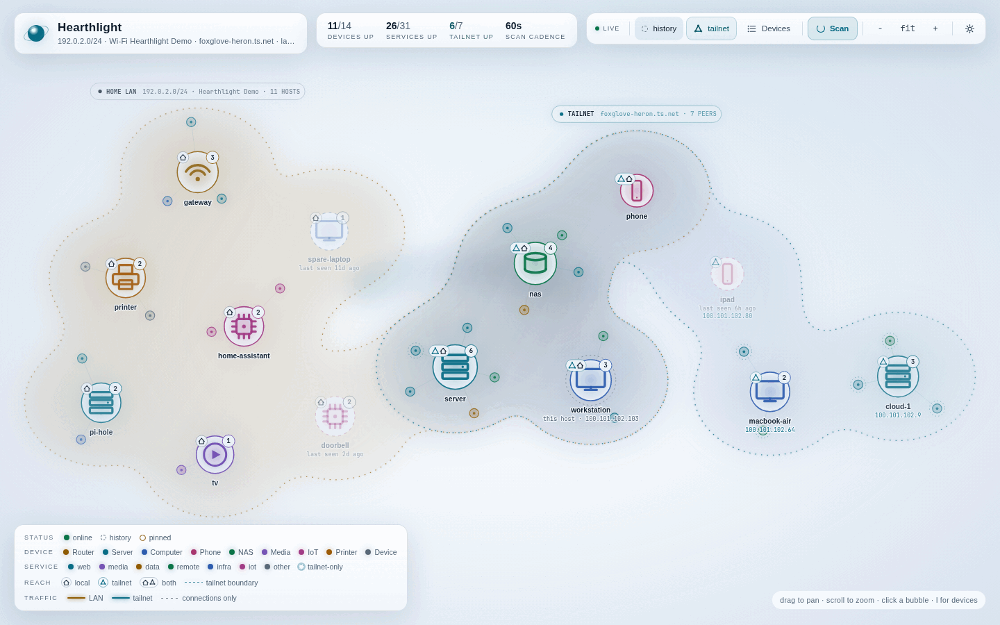
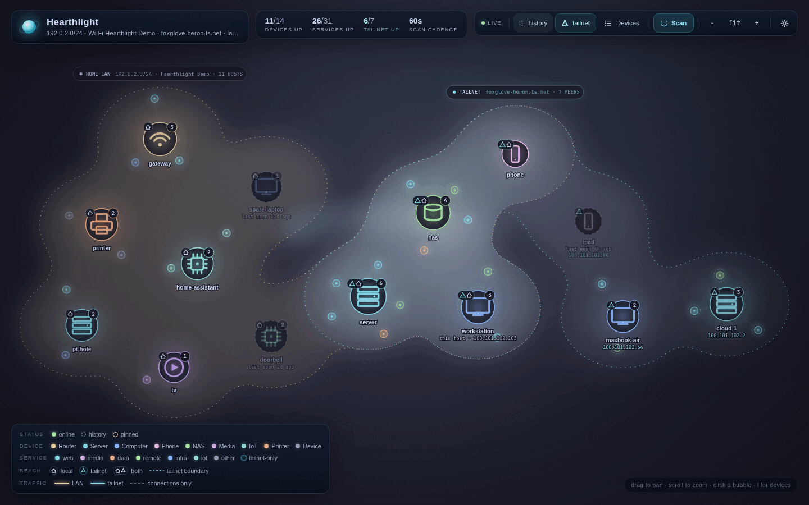
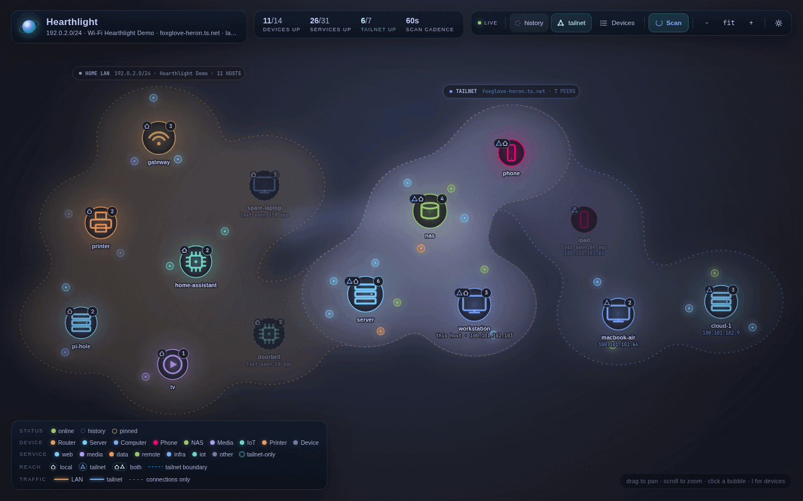
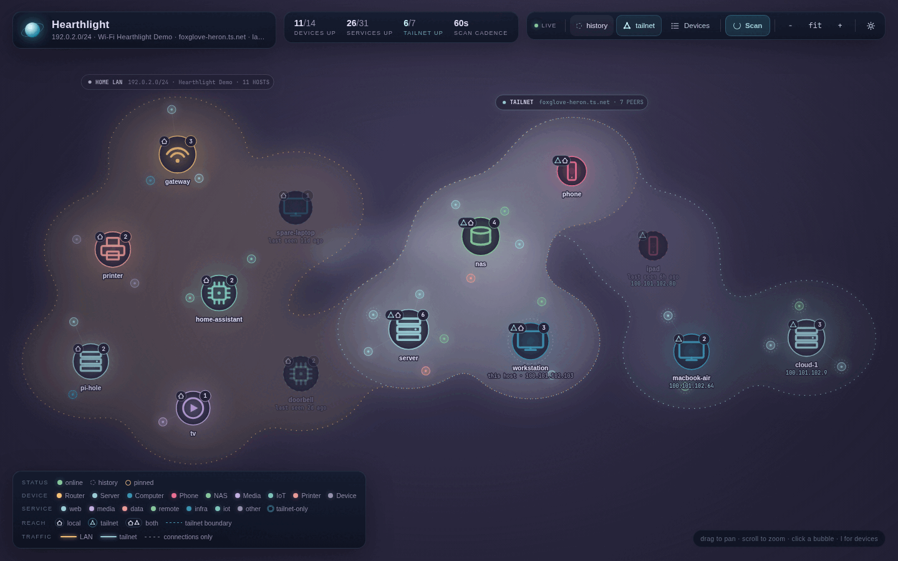
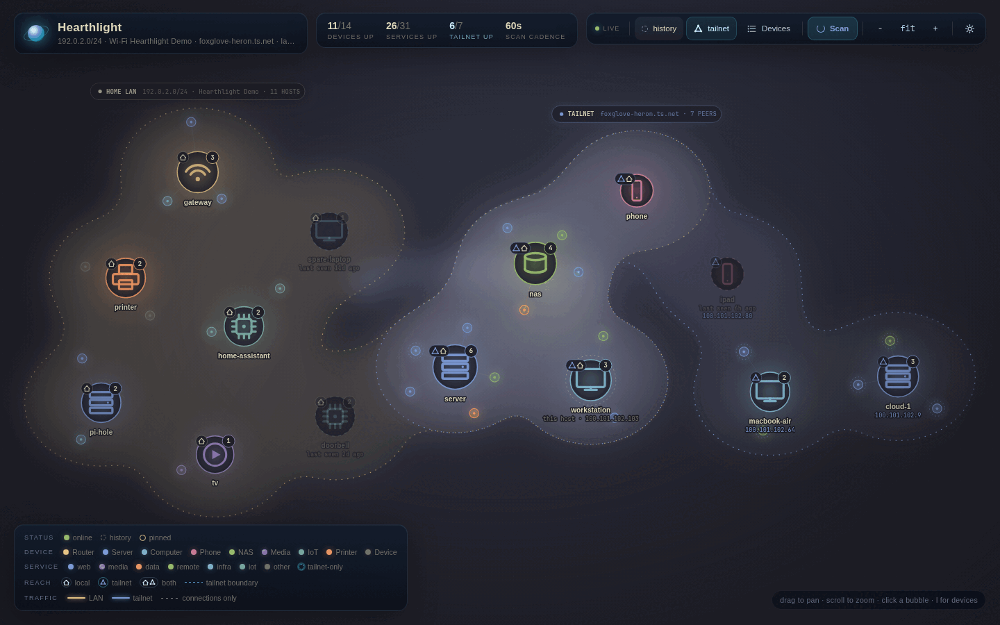

# Hearthlight themes

Hearthlight draws the map with a palette from `web/themes.json`. The same
catalog drives the Settings picker, the CSS custom properties and the canvas
renderer. This page lists every shipped family and variant, shows a screenshot
of each one, and explains how to add another.

The table and gallery below are generated from the catalog by
`scripts/theme-gallery.sh`. Do not edit them by hand. Add or change the theme in
`web/themes.json`, then rerun the script.

The Settings dialog in this build does not link to this page yet. Open the page
from the README or the repository docs.

## Families and variants

<!-- BEGIN THEME TABLE -->
| Variant | ID | Family | Mode | Source | Omarchy stock | Preview |
| --- | --- | --- | --- | --- | --- | --- |
| Hearthlight Dark | `hearthlight-dark` | Hearthlight | dark | Hearthlight original | No, Hearthlight original. | [Preview](themes/hearthlight-dark.png) |
| Hearthlight Light | `hearthlight-light` | Hearthlight | light | Hearthlight original | No, Hearthlight original. | [Preview](themes/hearthlight-light.png) |
| Catppuccin Mocha | `catppuccin-mocha` | Catppuccin | dark | [Catppuccin](https://github.com/catppuccin/catppuccin) | Yes. Omarchy `catppuccin`. | [Preview](themes/catppuccin-mocha.png) |
| Tokyo Night | `tokyo-night` | Tokyo Night | dark | [Tokyo Night](https://github.com/folke/tokyonight.nvim) | Yes. Omarchy `tokyo-night`. | [Preview](themes/tokyo-night.png) |
| Rosé Pine Moon | `rose-pine-moon` | Rosé Pine | dark | [Rosé Pine](https://rosepinetheme.com/) | No. Omarchy stock `rose-pine` is the light Dawn palette. | [Preview](themes/rose-pine-moon.png) |
| Kanagawa Wave | `kanagawa-wave` | Kanagawa | dark | [Kanagawa](https://github.com/rebelot/kanagawa.nvim) | Yes. Omarchy `kanagawa`. | [Preview](themes/kanagawa-wave.png) |
<!-- END THEME TABLE -->

`Omarchy stock` describes the stock Omarchy theme that the variant is intended
to match. The mapping itself is still tracked in
[#22](https://github.com/jmkelly/hearthlight/issues/22) and is not served by this
build. Omarchy's `rose-pine` theme is the light Dawn palette. Hearthlight ships
Rosé Pine Moon, a dark palette, so it is not the stock mapping.

## Gallery

Every image uses demo mode at a 1440x900 viewport with reduced motion enabled.
Transient traffic edges are disabled so the map is comparable between runs.

<!-- BEGIN THEME GALLERY -->
### Hearthlight

#### Hearthlight Dark



#### Hearthlight Light



### Catppuccin

#### Catppuccin Mocha



### Tokyo Night

#### Tokyo Night



### Rosé Pine

#### Rosé Pine Moon



### Kanagawa

#### Kanagawa Wave


<!-- END THEME GALLERY -->

## Hearthlight-authored interpretations

Hearthlight Dark and Hearthlight Light are original Hearthlight palettes.

The third-party families are Hearthlight-authored interpretations of published
palettes, not official ports. Catppuccin Mocha, Tokyo Night, Rosé Pine Moon and
Kanagawa Wave use colours from their upstream projects, then assign Hearthlight's
semantic tokens, device kinds, service categories and effect values. Upstream
projects may ship other variants, different defaults or later palette changes.
The source link in the table points at the project Hearthlight interpreted.

Rosé Pine Moon is not the Omarchy stock Rosé Pine variant. Omarchy currently
maps its `rose-pine` theme to the light Dawn palette, which Hearthlight does not
ship yet.

## How themes work

`web/themes.json` is the canonical catalog. It has `schemaVersion: 1` and a
`families` array. Each family has an `id`, a `name`, an optional `source` object
with `name` and `url`, and a `variants` array. Each variant has an `id`, a
`name`, a `mode` of `dark` or `light`, and the palette, kind, category and effect
data.

`web/themes.js` is generated from `web/themes.json`:

```bash
make themes
```

That command writes `window.HearthlightThemes = <catalog>;`. Never edit
`web/themes.js` by hand. A test fails when it is stale or when the embedded copy
in the Go binary differs from the checked-in file.

`web/index.html` loads `themes.js` and `theme-boot.js` in the document head,
before the stylesheet. `theme-boot.js` reads the stored preference, applies any
URL override, resolves the mode, and sets CSS custom properties on the root
element. It also sets `data-theme` to the family ID and `data-mode` to the
resolved mode. The renderer reads the same values from
`window.HearthlightTheme.resolve()` and applies the palette to the canvas.

The stored preference is the JSON object under `hearthlight.theme.v1`:

```json
{ "family": "hearthlight", "mode": "dark" }
```

`mode` is `dark`, `light` or `auto`. Auto resolves with
`prefers-color-scheme`, and the page updates when the operating system changes.
If a family has no variant for the resolved mode, the boot script falls back to
the family's dark variant or its first variant and marks the result as a
fallback. Settings shows a note when that happens.

The read-only catalog is also available at `GET /api/themes`.

### URL overrides

`?theme=<variant-id>` selects an exact variant for that page load. `?mode=dark`,
`?mode=light` or `?mode=auto` changes only the mode and keeps the stored family.
An unknown variant, unknown mode or invalid value is ignored and the stored
preference applies. URL overrides are not persisted.

### Palette tokens

Every variant must define these palette tokens:

| Token | Used for |
| --- | --- |
| `bg` | Page background and base surface. |
| `ink` | Primary text and high-contrast marks. |
| `muted` | Secondary text and quiet labels. |
| `accent` | Focus, selection, links and tailnet highlights. |
| `line` | Borders and dividers. |
| `glass` | Glass panel fill. |
| `canvasTop` | Map canvas gradient at the top. |
| `canvasMiddle` | Map canvas gradient in the middle. |
| `canvasBottom` | Map canvas gradient at the bottom. |
| `grid` | Canvas grid lines. |
| `ambientGlow` | Ambient colour behind the territories. |
| `online` | Online state and live indicators. |
| `warning` | LAN traffic, warnings and warm state. |
| `danger` | Errors and destructive state. |
| `history` | Historic devices and services. |
| `vignette` | Edge shading over the canvas. |
| `labelHalo` | Text halo behind map labels. |
| `bubble` | Device bubble fill. |
| `panel` | Detail panel and settings surface. |

Camel case names become kebab-case CSS custom properties. For example,
`canvasTop` becomes `--theme-canvas-top`.

Each variant also needs all nine `kinds` entries, each with a `label` and a
`color`: `router`, `server`, `computer`, `phone`, `nas`, `media`, `iot`,
`printer`, `device`.

The seven `categories` entries are `web`, `media`, `data`, `remote`, `infra`,
`iot` and `other`, each with a colour.

Effects tune the renderer rather than the palette:

| Effect | Controls |
| --- | --- |
| `vignette` | Vignette strength, usually 0 to 1. |
| `deviceGlow` | Glow around device bubbles. |
| `devicePulse` | Pulse strength for online devices. |
| `serviceGlow` | Glow around service bubbles. |
| `territoryBlur` | Blur applied to territory fills. |
| `ribbonBlur` | Blur applied to the LAN and tailnet ribbons. |
| `lensBlur` | Blur applied to the overlap lens. |
| `glassBlur` | Blur behind glass panels. |
| `panelBlur` | Blur behind the detail panel. |
| `territoryBlend` | Canvas composite operation, normally `screen`. |
| `territoryAlpha` | Opacity multiplier for territory fills. |
| `glowStrength` | Global glow multiplier. |
| `labelHalo` | Halo opacity for map labels. |
| `shadowStrength` | Shadow multiplier for device and service marks. |

All effect values except `territoryBlend` are finite, non-negative numbers.

## Adding a theme

1. Add a family and variant to `web/themes.json`. Family IDs and variant IDs use
   kebab-case and must be unique. A variant ID is global across families because
   `?theme=` accepts a variant ID. Variant IDs also cannot repeat a word, so
   `tokyo-night` is valid and `tokyo-tokyo` is not.
2. Set `mode` to `dark` or `light`. Do not invent a light variant for a dark-only
   palette just to fill the slot. Auto falls back and Settings explains it.
3. Add a `source` object for a third-party palette:

   ```json
   "source": {
     "name": "Example Palette",
     "url": "https://example.com/palette"
   }
   ```

   Credit the project you interpreted. If you adjust a colour for contrast,
   record that in the source name or in your pull request description. Do not
   call an interpretation an official port.
4. Define every palette token, every kind, every category and every effect
   listed above. Copying a variant and replacing the palette is the normal path.
5. Run `make themes` to regenerate `web/themes.js`.
6. Run `make check`. It checks formatting, vet and tests. The theme tests validate
   the schema, required tokens and effects, kebab-case IDs, distinct kind and
   category colours for dark variants, light-mode text contrast, freshness of
   `web/themes.js` and that the embedded files match the checkout.
7. Capture the new variant and refresh this page:

   ```bash
   ./scripts/theme-gallery.sh
   ```

   The script updates the table and gallery from the catalog, captures a
   1440x900 demo screenshot for every variant when a headless Chromium is
   available, and optimises the images under `docs/themes/`. It needs Go and
   Python 3. ImageMagick's `magick` or `convert` optimises the PNGs; without it
   the screenshots stay uncompressed. Set `BROWSER` to choose a specific
   Chromium or Chrome executable.

### Contrast targets

Use WCAG 2.2 relative luminance and contrast ratio. The full automated guard is
tracked in [#24](https://github.com/jmkelly/hearthlight/issues/24); the current
test suite enforces the required tokens, distinct map colours and a 7:1
light-mode `ink` contrast for Hearthlight Light.

| Pair | Minimum |
| --- | --- |
| Body text (`ink`) on `bg`, `bubble` or `panel` | 4.5:1 |
| Labels over the canvas (`ink` on `labelHalo`) | 4.5:1 |
| Focus ring (`accent`) against the adjacent background | 3:1 |
| Device and service marks, territory boundaries, traffic edges, reach badges | 3:1 |
| Status colours (`online`, `history`) against the canvas | 3:1 |
| Category and kind dots against `bubble` or the canvas | 3:1 |

Canonical palettes sometimes miss these values. Adjust lightness or chroma while
keeping the palette's character, then note the adjustment. Do not lower the
target.

## Omarchy

**Status.** The Omarchy plugin and stock mapping are not shipped in this build.
This section documents the intended integration from
[#22](https://github.com/jmkelly/hearthlight/issues/22) and
[#23](https://github.com/jmkelly/hearthlight/issues/23) so the gallery does not
pretend otherwise. There is no `-omarchy-theme` flag in this build.

### Stock mapping

The planned mapping lives in `web/omarchy.json` and maps Omarchy theme names to
Hearthlight variant IDs. The canonical stock list is the `themes/*/colors.toml`
tree in the [Omarchy repository](https://github.com/omacom/omarchy/tree/quattro/themes).
The current catalog already covers these stock names:

| Omarchy theme | Hearthlight variant | Status |
| --- | --- | --- |
| `catppuccin` | `catppuccin-mocha` | Shipped variant, mapping pending. |
| `kanagawa` | `kanagawa-wave` | Shipped variant, mapping pending. |
| `tokyo-night` | `tokyo-night` | Shipped variant, mapping pending. |
| `rose-pine` | `rose-pine-dawn` | Not shipped. Omarchy's stock `rose-pine` is the light Dawn palette. |

The other stock Omarchy names need new palettes before they can map. Track that
work in #22. Do not infer a variant from a family name, because Omarchy's
`rose-pine` is light while Hearthlight's Rosé Pine family is dark.

### Plugin install

Once the plugin repository is published, install it with the normal Omarchy
plugin command:

```bash
omarchy plugin add jmkelly/omarchy-hearthlight-theme --enable
```

The plugin has its own `README.md` for install, update, uninstall and security
notes. It is a service plugin, not a standalone daemon.

### Files

The plugin watches the active Omarchy theme:

- `~/.local/state/omarchy/current/theme.name`
- `~/.local/state/omarchy/current/theme/colors.toml`
- `~/.local/state/omarchy/current/theme.generation`

It writes a normalized palette atomically to:

```text
~/.config/hearthlight/omarchy-theme.json
```

The file is written with mode `0600`. The planned Hearthlight side watches that
file and exposes it as a read-only theme source. The plugin never fails an
Omarchy theme switch when Hearthlight is down; it logs once and keeps the last
good file.

For a non-plugin setup, the same file can be written from an Omarchy theme hook
under `~/.config/omarchy/hooks/theme-set.d/`. Both paths use the same schema.

### Unsandboxed caveat

Omarchy plugins run unsandboxed inside the long-lived shell process. Keep the
service small, avoid shelling out for every read, and limit it to the files
listed above. The planned Hearthlight side only reads the normalized file. It
does not add an unauthenticated write endpoint to the HTTP API. Remote live sync
is a follow-up.

Until the integration ships, pick the closest family manually in Settings.
Catppuccin, Kanagawa and Tokyo Night match their stock Omarchy themes. Rosé Pine
Moon is a dark interpretation, not Omarchy's Dawn palette.

## Troubleshooting

### The theme does not stick

Theme selection is per browser. It is stored in `localStorage` under
`hearthlight.theme.v1` and is never sent to the server. A different browser,
device or profile keeps its own choice.

Private browsing and hardened browser settings can disable `localStorage`.
Hearthlight still applies the theme for the current page, but it cannot remember
it after a reload. Try a normal window or allow site data for the Hearthlight
origin. Clearing site data also resets the choice.

To inspect the stored value, open the browser console on the Hearthlight page:

```js
localStorage.getItem("hearthlight.theme.v1")
```

### Flash of the default theme on load

`themes.js` and `theme-boot.js` must load in the document head before the
stylesheet. Both are small, blocking scripts served by Hearthlight itself. If the
page flashes Hearthlight Dark before applying a stored or URL theme, check that
`/themes.js` and `/theme-boot.js` return 200, that a reverse proxy or CSP is not
blocking them, and that a stale cache is not serving an old `index.html`. A hard
reload usually clears it.

`theme-boot.js` catches storage and query parsing failures and falls back to the
default. A disabled `localStorage` produces the default on every load, not a
flash after first paint.

### Light or Auto shows a dark palette

Some families ship only a dark variant. Light and Auto fall back to the available
palette, and Settings shows a note. That is intentional. Use Hearthlight Light or
another family with a light variant when you need a light map.

### `?theme=` is ignored

`theme` takes a variant ID, not a family ID. Use an ID from the table, such as
`hearthlight-light` or `kanagawa-wave`. An unknown ID, an unknown mode or a
malformed query is ignored, and the stored preference applies. The override is
not saved.

### Omarchy theme not detected

Omarchy support is not part of this build, so no theme will be detected yet.
Once the plugin and server support land, check the following in order:

1. The plugin is enabled with `omarchy plugin list`.
2. The active theme is readable with `omarchy theme current` and
   `cat ~/.local/state/omarchy/current/theme.name`.
3. The plugin wrote `~/.config/hearthlight/omarchy-theme.json` with mode `0600`.
4. Hearthlight runs as the same user that owns the Omarchy state and config
   files. A service user with a different home directory will not see them.
5. Hearthlight was started with the Omarchy theme options for that build.

If the file disappears or is malformed, Hearthlight keeps the last applied theme
and shows an unavailable note. It does not reset the manual selection.
